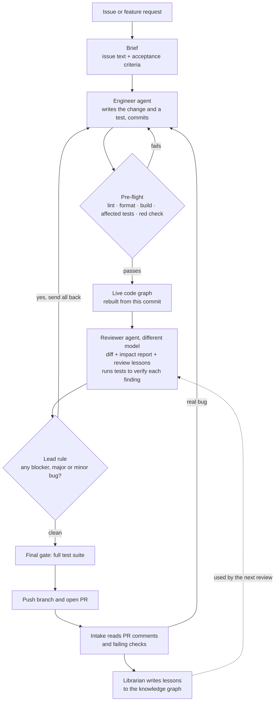
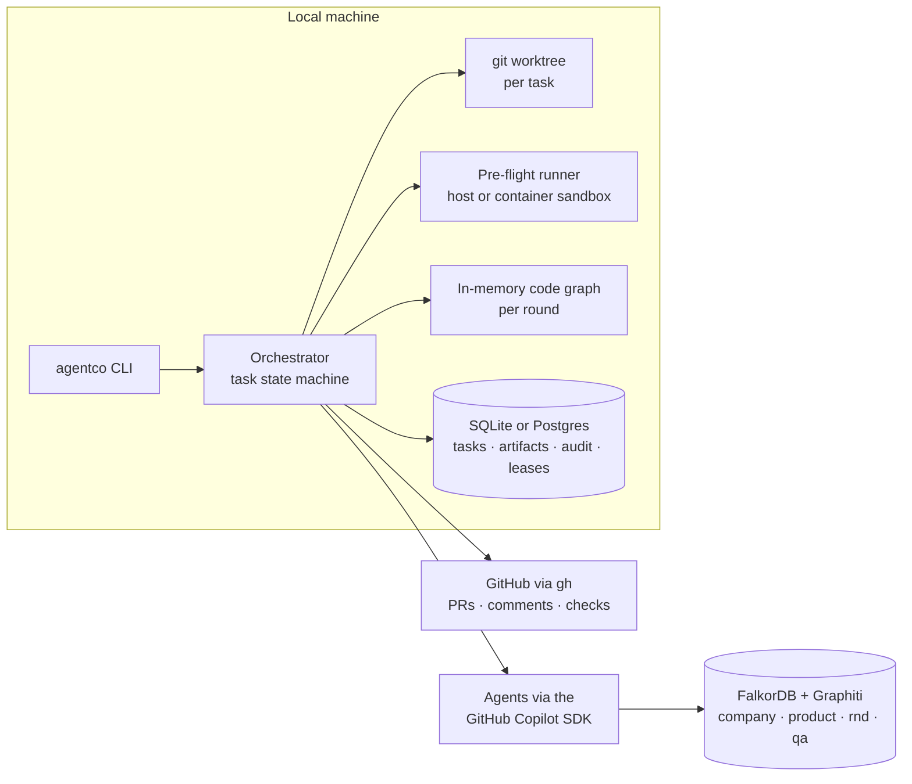

<div align="center">

# agentco

**An engineering team of AI agents that settles code review before the pull request opens.**

[](https://www.python.org/)
[](https://docs.astral.sh/uv/)
[](https://www.falkordb.com/)
[](https://github.com/getzep/graphiti)
[](https://github.com/features/copilot)
[](https://docs.astral.sh/ruff/)
[](#development)
[](#status)

[Why](#why-agentco) · [Results](#results) · [How it works](#how-it-works) · [Quick start](#quick-start) · [Commands](#command-reference) · [Configuration](#configuration) · [Guides](#guides)

</div>

---

## Why agentco

The usual AI coding loop is a ping-pong game:

```text
agent writes the fix → you open a PR → CodeRabbit / Copilot comment → you paste the comments
back to the agent → it pushes a fix → the bots find something new → ...
```

The coding agent and the review bot never talk to each other, the bot only wakes up after
the PR exists, and **you** carry every comment between them.

agentco runs that whole loop **locally, before the PR exists**. A strong engineer agent
writes the change, a reviewer agent on a *different* model reviews it the way a PR bot
would, and they go back and forth automatically until the review is clean. The PR opens
last, after the review has nothing left to report and the full test suite passes.

## Results

Benchmark: 3 real issues from this repository, the same models for every run, all local
(no PRs opened). An independent strict review agent checked every final diff.

| Approach | Blocking findings left after the run | Time per issue |
|---|---|---|
| Plain coding agent (first pass) | 2 / 0 / 1 | 17 / 9 / 19 min, including its review loop |
| agentco, full company pipeline | 3 / 1 / 3 | 38 / 54 / 61 min |
| **agentco, fast mode** | **0 / 0 / 0** | **10 / 12 / 19 min** |

Fast mode was as fast as a plain agent, and left nothing for the outside reviewer to block
on. Three bug fixes is a small sample: treat these numbers as an early signal, not proof.

## How it works

### The fast-mode loop



| Step | Who | What happens |
|---|---|---|
| 1. Brief | Rule | The issue text is the brief; its bullet lines become the acceptance criteria. |
| 2. Worktree | git | Each task works on its own branch (`agentco/task-N`) in its own git worktree. |
| 3. Engineer | Senior agent | Writes the change and a regression test, then commits. From round 2 it also gets the reviewer's findings and the impact report. |
| 4. Pre-flight | Script | Lint, format check and build; only the tests that reach the changed code; a **red check** that the new test fails on the original code. Any failure goes straight back to the engineer. |
| 5. Impact | Code graph | The repository is parsed into functions and call edges from the engineer's latest commit. The report lists every changed function, its callers and the tests that reach it. |
| 6. Review | Reviewer agent | Reviews the whole diff like CodeRabbit or Copilot would, with the impact report and past review lessons. It can run the lint and specific test files to prove a finding. It returns structured findings with a severity. |
| 7. Decision | Rule | Every blocker, major or minor bug goes back to the engineer in one batch. A clean review is approved. After `budgets.max_rounds` rounds the task stops and asks you. |
| 8. Final gate | Script | The full test suite runs once. Only then is the branch pushed and the PR opened. |
| 9. Feedback | Intake + Librarian | Comments from your team and allow-listed review bots, plus failing checks, come back into the same loop. The Librarian turns them into review lessons for next time. |

### What makes the difference

- **Review before the PR, not after.** The ping-pong still happens, but it is automatic and
  local, about one to two minutes per round, and finished before anyone sees the PR.
- **A second model reviews.** The reviewer runs on a different model family from the
  engineer, so it does not share its blind spots.
- **The graph says what else can break.** The reviewer checks every caller of the changed
  code, not just the changed lines.
- **Findings are verified.** The reviewer runs tests to prove each finding, and the red check
  proves the new test actually tests the fix.
- **Fast rounds.** Only the affected tests run each round; the full suite runs once, at the end.

### Architecture



| Component | Technology | Holds | Lifetime |
|---|---|---|---|
| **Code graph, per round** | tree-sitter parser, in memory | Functions, classes, call edges, the tests that reach them | Rebuilt from scratch from each round's commit. Never written to the shared graph, so unmerged code cannot leak into memory. |
| **Code graph, shared** | FalkorDB (`<tenant>__rnd`) | The indexed default branch (`agentco index`) | Incremental; updated by `index` and `import`. |
| **Knowledge graph** | FalkorDB + Graphiti, one graph per scope | Review rules, risks, escaped bugs, policies, escalation rules, human decisions | Grows over time; written by the Librarian, `import` and `init`. |
| **Task state** | SQLite (default) or Postgres via SQLAlchemy | Task state machine, every review and pre-flight result, audit log, leases | Per installation. |
| **Agents** | GitHub Copilot SDK | Engineer, reviewer and the other roles, each with its own model | Per call. |

One FalkorDB instance holds four graphs per tenant (`<tenant>__company`, `__product`,
`__rnd`, `__qa`). Each role reads and writes only the scopes it is allowed to, so product
knowledge and R&D knowledge stay separate while the whole company shares one database.

### Two pipelines

| | `pipeline: fast` (recommended) | `pipeline: company` (default) |
|---|---|---|
| Agents per round | Engineer + reviewer | PM, triage, junior or senior engineer, architect, reviewer, QA, lead |
| PM, triage, lead | Rules, no LLM | LLM agents |
| Pre-flight | Every round, affected tests only; full suite before the PR | Every round |
| Best for | Bugs and features where speed and a clean first review matter | Larger work that needs product framing and design records |

## Quick start

### 1. Prerequisites

| Tool | Version | Used for |
|---|---|---|
| Python | 3.12+ | Runtime |
| [uv](https://docs.astral.sh/uv/) | latest | Dependencies and running the CLI |
| Docker | any recent | FalkorDB (and the optional container sandbox) |
| [GitHub CLI](https://cli.github.com) `gh` | 2.48+ | Pull requests, comments, checks (`gh auth login`) |
| [GitHub Copilot CLI](https://docs.github.com/copilot) | signed in | Runs the agents through the Copilot SDK |
| `OPENAI_API_KEY` | — | Graphiti extraction and embeddings for memory |

### 2. Install and start FalkorDB

```bash
git clone https://github.com/Naseem77/agentco.git
cd agentco
uv sync
docker compose up -d falkordb        # FalkorDB on localhost:6379, browser UI on localhost:3000
export OPENAI_API_KEY=sk-...
```

### 3. Configure agentco

Create `agentco.config.yml` in the directory you run agentco from:

```yaml
tenant: acme                          # your company; graphs are named acme__rnd, acme__qa, ...
roles:
  pm:        { model: claude-haiku-5.5,  family: anthropic }
  triage:    { model: claude-haiku-5.5,  family: anthropic }
  architect: { model: claude-opus-5.5,   family: anthropic }
  senior:    { model: claude-sonnet-5.5, family: anthropic }
  junior:    { model: claude-sonnet-5.5, family: anthropic }
  reviewer:  { model: gpt-6.1-sol,       family: openai }     # a different family from the engineers
  qa:        { model: gpt-6-luna,        family: openai }
  lead:      { model: grok-4.7,          family: xai }
  librarian: { model: claude-haiku-5.5,  family: anthropic }
loop:
  pipeline: fast
```

Then create the state database and the four graphs, and seed company memory (one time,
about 18 LLM calls):

```bash
uv run agentco init
```

### 4. Describe your repository

Add `.agentco.yml` at the root of the repository the team will work on. It tells the team
how to build and test it. Let the Architect propose one with
[`agentco onboard`](#onboard-a-repo), or write it yourself:

```yaml
build: uv sync -q
test: uv run pytest -q                   # the full suite, run once before the PR
test_files: uv run pytest -q {files}     # recommended: lets each round run only the affected tests
lint: uv run ruff check src tests
format: uv run ruff format --check src tests   # optional, read-only check
e2e: null                                # required key; a command or null
sandbox: { devcontainer: .devcontainer } # or { compose: docker-compose.yml, service: app }
```

### 5. Run your first task

```bash
uv run agentco task new "Login button does nothing on Safari" \
  --body "Clicking Login on Safari 17 does nothing. Expected: the login form submits."
uv run agentco task run 1 --repo owner/name --repo-path /path/to/repo
```

The task stops in one of three places:

| Final state | Meaning | What you do |
|---|---|---|
| `pr_open` | Review is clean, the full suite passed, and the PR is open | Review and merge it yourself |
| `awaiting_human` | The team needs a decision (round limit, budget, a question) | `uv run agentco inbox`, then `uv run agentco decide 1 approve` (or `reject`, or `answer --note "..."`) and run the task again |
| `cancelled` | You rejected it | Nothing |

**agentco never merges.** A PR opens only after the review is clean, and a human always merges.

### 6. Keep learning from your PRs (optional)

```bash
uv run agentco index  --repo owner/name --repo-path /path/to/repo   # code structure into the shared graph
uv run agentco import --repo owner/name --repo-path /path/to/repo --dry-run
uv run agentco import --repo owner/name --repo-path /path/to/repo --limit 200
```

`import` turns past issues, PRs and review comments, including CodeRabbit and Copilot
comments, into review lessons, so the reviewer starts with what your reviewers usually ask for.

## Command reference

| Command | What it does |
|---|---|
| `agentco init` | Create the state database and the four graphs; seed company memory |
| `agentco task new TITLE --body TEXT` | Create a task |
| `agentco task run ID \| --all --repo R --repo-path P` | Run tasks until they need you, open a PR, or are cancelled; resumable |
| `agentco inbox` | List tasks waiting for you |
| `agentco decide ID approve\|reject\|answer [--note] [--add-budget USD]` | Answer a waiting task |
| `agentco onboard --repo R --repo-path P` | Have the Architect propose `.agentco.yml` |
| `agentco index --repo R --repo-path P` | Index the code structure into the shared code graph |
| `agentco import --repo R --repo-path P [--dry-run] [--limit N] [--since DATE]` | Import issues, PRs and review comments into memory |
| `agentco intake --repo R` | Read comments and checks on open PRs; send real bugs back to the team |
| `agentco serve --repo R` | Webhook receiver that triggers intake on GitHub events |
| `agentco learn ID \| --all` | Rerun the Librarian |
| `agentco memory search --as ROLE QUERY` | Search the graphs a role may read |
| `agentco metrics [--since DAYS] [--json]` | Ping-pong, cost and time metrics per task |
| `agentco adr ID` | Print a task's latest architecture decision record |
| `agentco pool fill --repo-path P` | Prepare warm worktrees ahead of time |

Every command takes `--config PATH` (default `agentco.config.yml`).

## Configuration

`agentco.config.yml` rejects unknown keys. Every role is required, and the reviewer, QA and
lead must use a different model from the engineers. The full option list is in the
[design spec §10](docs/superpowers/specs/2026-11-04-agent-company-design.md).

| Key | Default | Meaning |
|---|---|---|
| `tenant` | — | Company name; prefixes every graph (`<tenant>__rnd`, ...) |
| `roles.<role>` | — | `{ model, family }` per role |
| `database_url` | `sqlite:///.agentco/state.db` | Task state; a relative sqlite path is resolved against the config file |
| `falkordb_port` | `6379` | FalkorDB port on localhost |
| `loop.pipeline` | `company` | `fast` or `company` |
| `budgets.max_rounds` | `3` | Review rounds before a task stops and asks you |
| `budgets.per_task_usd` | `5` | Spending limit per task |
| `loop.max_changed_lines` | `400` | Largest diff a task may produce |
| `loop.command_timeout_s` | `900` | Timeout for one build or test command |
| `intake.review_bots` | Copilot, CodeRabbit | Bot accounts whose PR comments count as feedback |
| `memory_models` | `gpt-5.5`, `gpt-4.1-mini`, `text-embedding-3-small` | Graphiti's OpenAI models |

`AGENTCO_GRAPHITI_MODEL` and `AGENTCO_GRAPHITI_SMALL_MODEL` override `memory_models.model`
and `memory_models.small_model`.

## Security

**Commands the agents write run on your machine** when you use `--host`, with a reduced
environment: only `PATH`, `HOME`, `LANG`, `LC_*`, `TERM`, `TMPDIR`, `USER`, `LOGNAME` and the
variables listed in `env_passthrough` in `.agentco.yml` are passed on, so API keys and tokens
(`OPENAI_API_KEY`, `GH_TOKEN`, `AWS_*`, ...) are not visible to them. This does not isolate
the filesystem or the network, and an agent's own shell tool is limited only by its
permission policy. Use the container sandbox, and do not feed untrusted text (such as issues
from strangers) to the team without it.

- The reviewer's shell is allow-listed to the repository's exact lint, format and test
  commands, plus `git status` and `git diff`; shell metacharacters are rejected.
- Nothing is ever merged, and a PR opens only after approval.
- Webhooks are HMAC-verified; see [Webhooks](#webhooks-and-one-intake-per-repo-agentco-serve).

## Guides

- [Run a task](#run-a-task)
- [Onboard a repo](#onboard-a-repo)
- [PR feedback](#pr-feedback)
- [Importing a repo](#importing-a-repo)
- [What agentco learns](#what-agentco-learns)
- [Metrics](#metrics)
- [Webhooks and one intake per repo](#webhooks-and-one-intake-per-repo-agentco-serve)

### Run a task

Prerequisites: `init` done, FalkorDB and `OPENAI_API_KEY` as above, the
GitHub Copilot CLI signed in (the agents run through the Copilot SDK), `git` and `gh`. The
target repo needs a `.agentco.yml` at its root that tells the team how to build and test it:

```yaml
build: make build
test: make test
e2e: null                       # or a command; the key is required
lint: make lint
sandbox: { devcontainer: .devcontainer }   # or { compose: docker-compose.yml, service: app }
test_files: pytest {files}      # optional: run only the tests a change affects
env_passthrough: []             # optional: host variables the commands may see
```

```bash
uv run agentco task new "Graph switch flickers" --body "Switching graphs flickers for a frame..."
uv run agentco task run 1 --repo owner/name --repo-path .   # or --all
uv run agentco inbox                                        # tasks waiting for you
uv run agentco decide 1 approve                             # or: reject | answer --note "..."
uv run agentco task run 1 --repo owner/name --repo-path .   # carries on from your decision
```

`task run` works on a branch in its own git worktree and prints the final state per task. It
stops when the task needs you (`awaiting_human`), opens its pull request (`pr_open`) or is
cancelled, and it resumes where it stopped when run again. `--all` runs every task that can
make progress, `cfg.concurrency` at a time; `--host` runs the repo's build and test commands
on this machine instead of in the sandbox.

**A PR opens only after approval, and a human always merges.** The team lead's approval (or
your `approve` on a lead escalation or a failed push) is the only way a branch is pushed and a
PR opened, and nothing here ever merges one. An `approve` on a budget or round stop, or after
the lead failed, just lets the team continue; the lead still has to approve.

`inbox` lists each waiting task with the category, the state it came from, why it stopped and
the options. `decide <id> approve|reject|answer` answers it: `answer` needs `--note`,
`reject` cancels the task at once, and `approve` or `answer` take effect on the next
`task run`. `--add-budget USD` raises that task's spending limit, which is how a task that
stopped on its budget continues. Every decision is also written to company memory as a human
decision.

Exit codes of `task run`: 1 bad arguments, config, checkout or repo contract, 2 FalkorDB
unreachable, 3 `gh` unavailable or failing or a git operation failed, 4 a step failed and the task stayed where it was
(run it again to retry). `decide` uses 1 and 2.

### Onboard a repo

A repo without `.agentco.yml` can get one proposed by the Architect:

```bash
uv run agentco onboard --repo owner/name --repo-path .   # reads the repo, prints a proposed .agentco.yml
uv run agentco inbox                                     # the proposal waits for you
uv run agentco decide 7 approve                          # or: answer --note "we use tox" | reject
uv run agentco onboard --repo owner/name --repo-path .   # writes the file after your approve
```

Nothing is written until you `approve`. The file is created in the local checkout only if
none exists (an existing `.agentco.yml` is never overwritten), and **agentco never commits or
pushes it**: review the file and commit it yourself. The proposal must be a valid contract
whose commands are each one plain command (no `&&`, `;`, `|`, `$`, redirects) and whose
`env_passthrough` is empty; the Architect gets one retry before the proposal escalates as
`stuck`. `answer` asks for a new draft with your note. Onboarding tasks never run with
`task run`.

### PR feedback

After a PR is open, `agentco intake` reads what people said about it and sends real problems
back to the team:

```bash
agentco intake --repo acme/app
```

It looks at review comments and reviews from your team (owners, members, collaborators), from
review bots you allow-listed in the config, and at failing checks. The lead classifies each
finding: a real bug goes back to triage and the same PR is updated (the branch is pushed with
`--force-with-lease`, the PR body is edited); nits are not worth a round and a tradeoff is
your call. When only nits or tradeoffs are left, you decide: the task stops in
`awaiting_human` and `agentco decide` continues it. A real bug that keeps coming back is bounded by the same round limit as any
task, after which it also stops for you.

Intake never comments on a PR and never merges. It only reads, and a PR you merged or closed
yourself marks its task `merged` or `cancelled`. Running it twice does the same as running it
once. Run it on a timer, then let the team pick the work up:

```cron
*/15 * * * * cd /path/to/repo && agentco intake --repo acme/app && agentco task run --all --repo acme/app
```

Intake prints one line per task (`#3 back to triage (round 1): 2 finding(s)`, `#4 needs a
human: stuck`, `#5 merged`) and a summary (`7 known, 1 deferred`). Exit codes: 1 bad
arguments or config, 2 FalkorDB unreachable, 3 `gh` unavailable or failing, 4 an agent step
failed (a rerun is safe), 0 otherwise.

### Importing a repo

Prerequisites: the `init` setup above (FalkorDB running, `OPENAI_API_KEY` set for Graphiti),
`git`, and the [GitHub CLI](https://cli.github.com) **2.48 or newer** (needed for
`gh api --slurp`), authenticated with `gh auth login`. A `--dry-run` needs neither FalkorDB
nor `OPENAI_API_KEY`, only `gh`.

```bash
uv run agentco index --repo owner/name --repo-path .                 # code structure → code graph
uv run agentco import --repo owner/name --repo-path . --dry-run      # counts only, writes nothing
uv run agentco import --repo owner/name --repo-path .                # the real import
```

`index` stores the checkout's functions, classes and call edges (git-tracked files only) in
the tenant's `rnd` graph and is incremental: unchanged files are not re-parsed. Its counts
`skipped` (working-tree files that were not indexed) and `deleted` (graph entries removed)
can overlap, so a file may appear in both. `--repo-path` may be any directory inside the
checkout; it is resolved to the repository root, and a directory outside a git repository
is rejected (exit 1).

`import` reads issues, pull requests and review comments through `gh`, oldest first, and
writes each one as an episode: issues and PRs to `rnd`, feature requests also to `product`.
**Each episode is one Graphiti extraction (several LLM calls)**, so run `--dry-run` first
and bound the work with `--limit N` (at least 1) or `--since YYYY-MM-DD`.

`--dry-run` imports nothing: it contacts only GitHub, creates no graphs, does not index and
builds neither the memory backend nor the code graph. It reads the "already imported"
markers from the local state database (`database_url`), which it creates if missing. It
reports the episodes that would be written (each one LLM extraction) and, separately, any
link-only retries (episodes already written whose code link is still pending; no LLM call).

Re-running is safe: imported items are remembered, and an interrupted or `--limit`ed run
resumes with the next-oldest items. Review threads started by a bot, by the PR's own author
or by a non-member are not imported, and neither are issues or PRs authored by bots.
`--since` only filters by creation date; it never sets the resume cursor, so a run with
`--since` does not make later plain runs skip anything.

#### Linking review comments to code

With `--repo-path`, `import` **indexes the checkout first and only then contacts GitHub**.
If `gh` fails (exit 3), the code graph has already been updated; that is harmless, since
indexing is incremental.

Each review comment is linked to the function or class it was written against, using the
file as it was at the comment's own commit:

- **Commit-accurate**: when the commit is in the checkout, the link is exact even if the
  code has moved since. Review commits of PRs that were merged or force-pushed are often
  missing from a clone; fetch the PR heads first:
  `git fetch origin '+refs/pull/*/head:refs/remotes/origin/pr/*'`
- **Best effort**: when the commit is missing, a comment on a line that still exists is
  resolved against the *current* code, which can point at a different function if the file
  changed. The run then prints `N episodes linked against current code because their
  commits are not in the checkout`. A comment whose line no longer exists (outdated) and
  whose commit is missing is not linked at all rather than guessed.

Reviews imported while no code graph was available (no `--repo-path` and an empty index)
stay pending: the next `import --repo-path ...` (or one after `agentco index`) links them
without writing the episodes again, and prints `relinked N episodes` (only when N > 0). The
resume cursor is held back while such reviews are pending, and the run reports
`N review episodes await a code graph`.

Exit codes: 1 bad arguments, config, a non-git `--repo-path` or an LLM error (e.g.
`OPENAI_API_KEY` missing, rate limit, refusal), 2 FalkorDB unreachable or rejecting a
query, 3 `gh` missing, not logged in, the repo not found, or `gh` returning unexpected JSON.

### What agentco learns

After `task run`, `decide` and `intake`, the Librarian turns what happened into company memory.
It reads only what the task stored, never the chat history:

- the lead's review comments become review rules (`rnd`);
- QA failures become issues (`rnd`); only title, steps, expected and actual, never the tests;
- a real bug found on a PR (not recurring) becomes a risk (`rnd`), an escaped bug and a
  neighbour case to test next time (`qa`);
- your `agentco decide` answers become escalation rules and policies (`company`), one or two at
  most per decision; approving over non-real findings over and over marks a rule stale;
- a merged task adds its invariant, what was solved and how its agents did, plus the human
  review comments on its PR; a cancelled one adds the agent profile only;
- after a merge, QA's regression tests become a follow-up task (`qa-followup`) that adds them
  to the repo through the normal PR path.

Nothing goes to `product`. Every lesson is a plain fact with its origin (`lead`, `human` or
`librarian`) and a provenance line, for example `Source: task:3:lead:12` (task, artifact kind,
artifact id), so you can trace it back. Lessons are deduplicated against what memory already
holds. Warnings (`warning: librarian #3: ...`) never change an exit code.

Everything is idempotent. To rerun the Librarian, for instance after FalkorDB was down or the
model failed:

```bash
agentco learn 3        # one task: prints "#3: 2 added, 1 duplicate"
agentco learn --all    # every task with something not yet learned
```

### Metrics

```bash
uv run agentco metrics                 # totals, then one row per task
uv run agentco metrics --since 30      # only tasks started in the last 30 days
uv run agentco metrics --json          # the same data as JSON
```

Everything is derived on read from the task store (audit log, artifacts, meta). There is no
extra table, and the command needs neither FalkorDB nor GitHub. It exits 1 only on a bad
config or bad `--since`.

Each number maps to a success metric of spec §9:

| Number | Spec §9 metric | Target |
|---|---|---|
| `pr_comments_per_pr` | human review rounds per PR after it opens (the real ping-pong metric): findings from comments, reviews and failing checks, per PR | **0** |
| `escaped_real_bugs` | escaped bugs: PR findings the lead classified `real_bug` | ↓ |
| `fix_round_findings` | % of bugs introduced by fixes: review findings in rounds after the first (a proxy) | ↓ |
| `avg_rounds`, `avg_pr_rounds` | internal rounds per task; the share of them that came from a PR | ↓ |
| `escalations`, `recurrences` | human pings (escalations to the inbox); findings that came back after a fix | ↓ |
| `pct_junior` | % of tasks done by the junior tier (merged tasks whose final assignee is junior) | ↑ |
| `premium_requests`, `cost_usd`, `median_duration_h` | cost per task; time from creation to merge or cancel | ↓ |

`tasks`, `merged` and `cancelled` count the tasks in the window. `stale rules` lists the
fingerprints of review findings that humans overrode at least `thresholds.stale_after`
times (default 3); retire those rules by hand.

### Webhooks and one intake per repo (`agentco serve`)

<!-- Plan 5, PR 4: keep this section self-contained so it merges cleanly. -->

Polling with `agentco intake` (see [PR feedback](#pr-feedback)) still works and always will.
`agentco serve` adds a push path for one repo: GitHub tells agentco when something happens,
and agentco runs the same intake right away instead of waiting for the next cron tick.

```bash
export AGENTCO_WEBHOOK_SECRET=...            # any long random string
agentco serve --repo acme/app                # 127.0.0.1:8787; --host / --port to change
```

In the repo's **Settings → Webhooks**, add a webhook with:

- **Payload URL:** `https://<your tunnel or proxy>/webhook`
- **Content type:** `application/json`
- **Secret:** the same value as `AGENTCO_WEBHOOK_SECRET`
- **Events:** `issues`, `pull_request`, `pull_request_review`,
  `pull_request_review_comment` and `check_run` (a `ping` is answered too; any other event
  is rejected)

What the receiver does, and what it refuses:

- The secret comes from the environment variable named by `webhook.secret_env` (default
  `AGENTCO_WEBHOOK_SECRET`), never from the config file. `serve` exits 1 if it is not set.
- Every request is checked with the `X-Hub-Signature-256` HMAC before anything is parsed.
  A missing or wrong signature gets 401; an unknown event, a payload for another repo or a
  malformed body gets 400; a missing `Content-Length` 411; a body over
  `webhook.max_body_bytes` (default 1 MiB) 413, without being read.
- A delivery id is handled once: GitHub redelivering it is answered `200 duplicate` and does
  not start an intake. A burst of different deliveries is coalesced into one running intake
  and at most one more after it (`webhook.debounce_s`, default 2 seconds, waits for the burst
  to settle).
- A webhook never creates a task and never carries data into the team: it only asks for an
  intake, which reads GitHub itself.

```yaml
webhook:
  secret_env: AGENTCO_WEBHOOK_SECRET   # name of the environment variable
  max_body_bytes: 1048576
  debounce_s: 2
```

`serve` speaks plain HTTP and binds to `127.0.0.1` by default. Reach it from GitHub only
through a tunnel or a reverse proxy that terminates TLS; do not expose the port directly.

**Only one intake per repo runs at a time**, across processes: `agentco intake`, cron and
`agentco serve` share a lease in the state database (`intake:<tenant>:<repo>`), released when
a run ends; if a process is killed mid-run, its lease expires after one hour. If one is already running, the other skips:
`agentco intake` prints `another intake for acme/app is running; skipped` and exits 0, and the
skipped run does not move the intake cursor, so the next run sees everything.

## Development

```bash
uv run pytest -q                  # unit tests; no Docker or network needed
uv run pytest -m integration      # needs FalkorDB on localhost:6379 and OPENAI_API_KEY
AGENTCO_IT_COPILOT=1 uv run pytest tests/test_task_loop_integration.py -m integration  # real Copilot agents
uv run ruff check src tests
```

Format check: `uv run ruff format --check src tests`. Design specs and implementation plans
live in [`docs/superpowers`](docs/superpowers); the fast-mode design is
[`2026-11-12-agentco-fast-mode-design.md`](docs/superpowers/specs/2026-11-12-agentco-fast-mode-design.md).

## Status

Beta, version 0.1.0. Interfaces and configuration may still change. The fast-mode results
above come from a three-issue benchmark; wider benchmarks are next.
