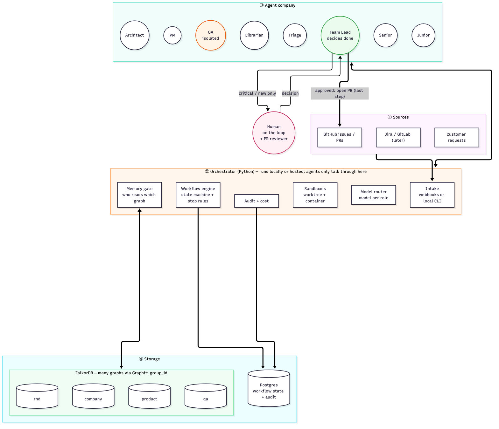
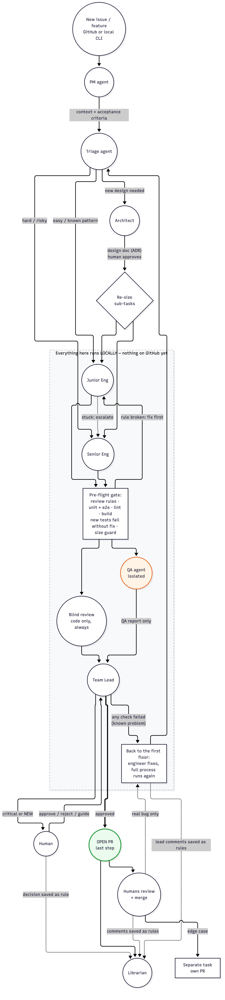
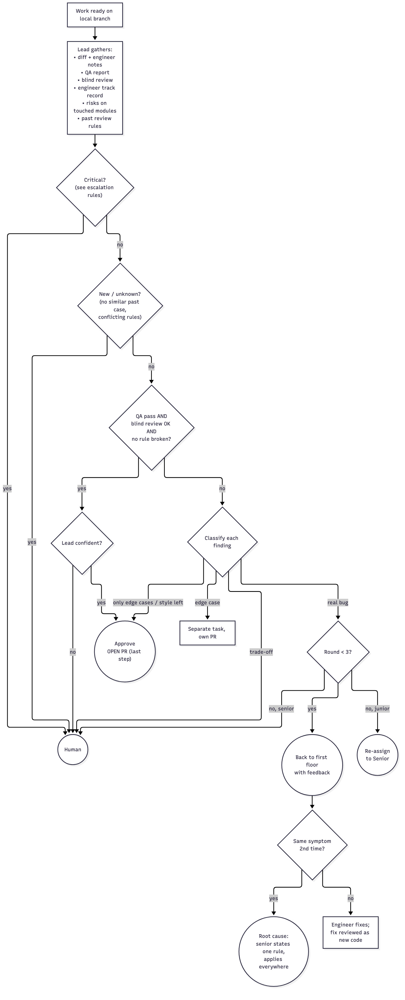
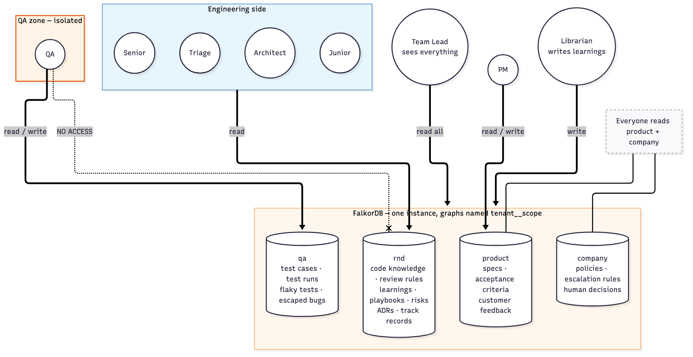
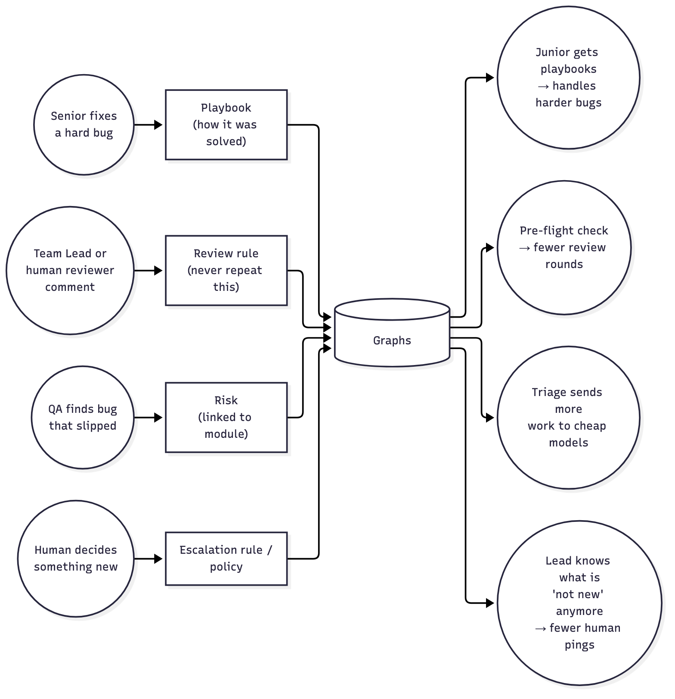

# Agent Company — Design

*Date: 2026-11-04 · Status: ready for your approval*

## 1. Intent — why this exists

Today, fixing a bug or shipping a feature turns into **review ping-pong**: open a PR → get comments → fix → new comment → fix again → a new issue appears. It never ends because:

- one model makes every decision alone, so nothing catches its blind spots;
- review feedback is forgotten, so the same comment comes back next time;
- easy and hard work get the same (expensive or under-qualified) treatment.

**The idea:** build a software company made of agents that works the way a good human team does.

- Everyone has a **role** (PM, triage, junior, senior, architect, QA, team lead).
- Work is **sized** and sent to the right level.
- Every delivery goes through **independent checks** (blind code review, isolated QA) and **only the team lead decides it's done**.
- All of that happens **locally, before GitHub sees anything**. The **pull request is opened last**, only after the team lead approves — so what humans review is already checked.
- What seniors and reviewers know is **saved into shared memory**, so juniors handle harder work over time and the same review comment never comes back twice.
- A **human is on the loop**, pulled in only when something is critical or new.

**Who it's for:** any software team eventually (multi-tenant product). **v1 is local-first for your own team** (see §14).

## 2. Goals, non-goals, anti-goals

**Goals**
1. Cut review rounds per PR (ping-pong) — measurable. PRs only open once they've passed blind review, QA and the lead.
2. Fewer escaped bugs, via independent QA and a lead gate.
3. Lower cost per task over time: as memory grows, triage sends more work to the cheap junior tier.
4. Humans only see what truly needs them.
5. Works for many teams (tenants), each with private memory.

**Non-goals (for now)**
- Replacing human product strategy or deciding *what* to build.
- Deploying to production by itself, or merging by itself — the system's last step is opening the PR.
- Non-GitHub sources in v1 (Jira/GitLab come later through the same intake).

**Anti-goals — failure even if it "works"**
- QA that just repeats what the engineer claimed (lost independence).
- A human pinged on every PR (defeats the purpose).
- Infinite loops between agents with no stop.
- Memory that fills with stale or wrong rules nobody can correct.
- One tenant's knowledge leaking into another's.

## 3. The big picture



Four layers:

| Layer | What it is |
|---|---|
| **Sources** | Where work comes from: GitHub issues, review comments on PRs, customer requests, or a local CLI command (`agentco task "..."`). Jira/GitLab later. |
| **Orchestrator** (Python) | Runs the company. Intake (webhooks or local CLI), workflow state machine, model router, **memory gate** (enforces who may read which graph), sandboxes, audit + cost tracking. Agents never talk to the database or each other directly — everything goes through the orchestrator. |
| **Run modes** | **Local:** CLI on a developer's machine, local git worktrees, FalkorDB + Postgres in Docker Compose (SQLite allowed instead of Postgres). **Hosted:** same code as a service with webhooks. In both, GitHub is only touched at the very end (open PR) and when reading issues/review comments. |
| **Agents** | The roles below. Each is a prompt + a model + a set of allowed tools and graphs. |
| **Memory** | One FalkorDB instance holding several graphs (via Graphiti `group_id`), plus Postgres for workflow state and the audit log. |

## 4. The roles

| Role | Job | Reads | Writes | Model (default, configurable) |
|---|---|---|---|---|
| **PM** | Turns raw requests into a clear issue: context, why, acceptance criteria. | product, company | product | cheap/fast |
| **Triage** | Sizes the task and assigns it: junior, senior, or architect. Uses similar past issues and who solved them. | rnd, product | (task record) | cheap/fast |
| **Architect** | For new designs: writes a short design decision (ADR), splits into sub-tasks. | rnd, product, company | rnd (Decision) | strongest |
| **Senior engineer** | Hard bugs, risky areas, root-cause work. | rnd, product, company | code (local branch) | Claude (strong) |
| **Blind reviewer** | **Required on every change.** A senior-level reviewer that sees **only the code** (diff + surrounding code + issue + acceptance criteria), never the engineer's notes or reasoning. Reviews fixes as new code. | rnd (rules + code structure, but **not** the current task's notes), product, company | review findings | different family from coder |
| **Junior engineer** | Easy / known-pattern work, using senior playbooks from memory. Can escalate when stuck. | rnd, product, company | code (local branch) | Claude (cheaper tier) |
| **QA** | **Isolated.** Tests behaviour against acceptance criteria. Never sees the engineer's reasoning. | qa, product, company | qa, QA report | different family from coder (e.g. GPT) |
| **Team Lead** | **Only one who can say "done."** Reads everything, decides approve / send back / escalate to human. **Approval is what opens the PR.** | rnd, qa, product, company | decision, review comments, opens PR | third family or strongest (e.g. Gemini) |
| **Librarian** | After each task, turns what happened into lasting memory: rules, playbooks, risks, track records. Cleans up stale or duplicate rules. | all of the tenant's graphs | rnd, qa, company | cheap/fast |
| **Human** | On the loop. Pulled in for critical or new things, and reviews/merges the final PR. Their review comments feed memory. | everything (UI) | decisions → company; PR comments → rnd | — |

*Different model families per role is deliberate:* the reviewer and QA shouldn't share the coder's blind spots. Models are set per role in tenant config (see §10).

## 5. The life of a task



1. **Intake.** A GitHub issue / customer request arrives through a webhook, or a developer starts it locally from the CLI.
2. **PM** enriches it: context, why it matters, acceptance criteria (stored in `product`).
3. **Triage** sizes it:
   - *easy / known pattern* (a similar past issue was solved, there's a playbook) → **Junior**
   - *hard / risky* (touches modules with risks, no playbook, wide blast radius) → **Senior**
   - *new design* (new feature, cross-cutting change) → **Architect** → ADR → sub-tasks re-sized → Junior/Senior
4. **Engineer works** on a **local branch** in an isolated worktree + container. A junior can **escalate** to senior mid-task if stuck (after N turns without progress).
5. **Pre-flight gate** (the anti-ping-pong step, all local, all must pass):
   - diff checked against **every review rule** in memory for the touched code — including rules learned from human reviewers;
   - **unit tests, end-to-end tests, lint and build** all pass;
   - **every new test fails without the fix** (the orchestrator reverts the non-test changes, runs the new tests, expects red) — so each test actually proves something;
   - **size guard**: the diff stays within the task's scope and a size budget (tighter on fix rounds). Anything outside scope is cut and filed as a separate task.
6. **Submitted for internal review** (still local, nothing on GitHub). Two independent checks run in parallel:
   - **Blind review** — always required. Sees only the code, not the reasoning (see §4). Reviews the fix itself as new code.
   - **QA** — isolated (see §7). Produces a **QA report**: pass/fail, evidence, tests run, **including the neighbour matrix**.
7. **Team Lead decides** (see §6).
8. **Approved → the PR is opened. This is the last step.** The PR description carries the lead's summary, QA result and linked issue. **Librarian** saves the learnings.
9. **After the PR is open**, humans review and merge it. Any human review comment is picked up by intake:
   - it becomes a **ReviewRule** (Librarian), so pre-flight catches it next time;
   - the lead first **classifies the finding** (see §6 "Is it a real problem?"); only real problems trigger a round;
   - a real problem sends the task **back to the first floor** with that comment, runs the full internal process again, and the lead pushes the update to the same PR.

**When a check fails → "back to the first floor."** The task goes back through triage to the engineer with the lead's feedback, and the **whole process runs again** (pre-flight, blind review, QA, lead). Every lead comment becomes a review rule immediately, so it can't come back again.

**Every fix is new code.** On a fix round, the fix's own diff is reviewed and tested as new code — not just "is the reported problem gone?". Bugs introduced by fixes are tracked as their own metric.

**Root cause, not symptom.** If the same symptom or the same area comes back a **second** time, the task can't just be patched again: it goes to a **senior** (or architect) who must state the **one rule (invariant)** that fixes the cause everywhere, and apply it. That rule is saved as a Playbook so the next fix in that area starts from it.

**Learning from all PRs.** Intake also reads human review comments on **PRs written by humans**, not just agent PRs. Those become ReviewRules too (no fix round — the agents don't touch human PRs). This is how the team's existing review standards get into memory.

**Stop rules (no infinite loops)**
- Max **3 rounds** per task.
- After 3 failed rounds by a **junior** → re-assigned to a **senior** (rounds reset once).
- After 3 failed rounds by a **senior** → **human**.
- Per-task cost budget; exceeding it → human.

## 6. The Team Lead's decision



The lead gathers **everything** before deciding:
- the diff and the engineer's notes,
- the **QA report** (only the report — the lead sees QA's result, QA never sees the engineer's notes),
- the **blind review**,
- the **engineer's track record** (past rounds, rules they've broken, escaped bugs in this area),
- **risks** linked to the touched modules,
- applicable **review rules**.

Then, in order:
1. **Critical?** → human.
2. **New / unknown?** → human.
3. **Any check failed?** → back to the first floor (see stop rules).
4. **All pass but lead not confident?** → human.
5. Otherwise → **approve**: push the branch and **open the PR** (last step).

If a human was pulled in and approves, the lead opens the PR too. Nothing reaches GitHub without the lead's approval.

### Is it a real problem? (when to stop)

Reviewers — human or AI, like Copilot review on the PR — **never say "done"**. So the lead classifies every finding, internal or from the PR:

| Finding | What happens |
|---|---|
| **Real bug** (wrong behaviour, crash, data/security issue) | Back to the first floor. |
| **Rare, harmless edge case** | Not fixed in this PR. Filed as a separate task → its own PR. |
| **Trade-off / opinion** | Human decides (one ping, with the options). |
| **Style already covered by a rule** | Fixed only if cheap; the rule is checked in pre-flight next time. |

**Stop condition:** when a round's findings contain **no real bugs**, the lead stops the loop, marks the PR "ready to merge", and pings the human to merge. Small, scoped fixes keep the next round's findings small.

### Escalation rules — when the human is pulled in

These live in the `company` graph as `EscalationRule` nodes, so each tenant can edit them. Defaults:

**Critical**
- Security-sensitive code: auth, permissions, crypto, secrets, input sanitisation.
- Data: migrations, deletes, schema changes on production data.
- Infrastructure / deployment / CI config.
- Breaking a public API or contract.
- Payments, billing, licensing, legal text.
- QA found a regression in a previously-fixed escaped bug.

**New / unknown**
- No similar past issue in memory (similarity below a threshold).
- Touches a module with no knowledge in the graph yet.
- Two review rules or policies conflict.
- An agent proposes a new dependency or a new architectural pattern not covered by an ADR.

**Stuck**
- Stop rules hit (see §5), or cost budget exceeded.

**Every human decision is saved** (as a `HumanDecision` + new/updated `EscalationRule` or `Policy`), so the same situation is *not new* next time. Human pings should go **down** over time.

## 7. QA isolation

QA must verify **behaviour**, not trust the engineer's story.

**QA gets:** the built branch (to run it and its tests), the acceptance criteria from `product`, company policies, its own `qa` history (test cases, flaky tests, bugs that slipped before).

**QA never gets:** the PR description (there is none yet — QA runs before the PR exists), commit messages, engineer notes, the `rnd` graph, or the blind review.

**Enforced, not requested:** the orchestrator's memory gate only hands QA a Graphiti client scoped to `qa` + `product` + `company`, and QA's sandbox gets a checkout of the local branch with commit messages squashed/neutralised.

**Test the neighbours, not just the reported case.** QA's `qa` graph holds a **neighbour matrix per bug class**, and QA must run it. Example for timing / state bugs: during loading · during a switch · switching back · when the page/component closes · two at once. Other classes (input validation, permissions, pagination, etc.) get their own matrices; the Librarian adds rows whenever a follow-up review finds a missed neighbour.

**Back-channel:** only QA's **outcome** (pass/fail + bug report) crosses into `rnd`, as a new issue linked by ID. The engineer gets the failure, never QA's reasoning — independence both ways.

## 8. Memory



**One FalkorDB instance, several graphs.** Graphiti maps each `group_id` to its own FalkorDB graph and fans out searches across several groups in parallel, merging results (verified in `graphiti_core/decorators.py`).

**Split by who may see it, not by kind of data.** Inside a graph, kinds are separated by node labels (Graphiti custom entity types). Reason: hops only work inside one graph, and Graphiti only de-duplicates entities inside one `group_id` — splitting "comments" from "learnings" from "risks" would break the chain *comment → learning → risk → module*.

**Naming:** `{tenant}__{scope}` → e.g. `acme__rnd`, `acme__qa`.

| Graph | Holds (entity types) |
|---|---|
| `company` | Policy, Convention, EscalationRule, HumanDecision |
| `product` | Feature, Spec, AcceptanceCriterion, Customer, Feedback |
| `rnd` | Module, File, Function, Class (code structure), Issue, PullRequest, ReviewComment, **ReviewRule**, **Learning**, **Playbook**, **Risk**, Decision (ADR), AgentProfile (track record) |
| `qa` | TestCase, TestRun, FlakyTest, EscapedBug, QALearning |

**Code structure (tree-sitter).** Review comments arrive as "file + line". To attach them to the right function/module — and to let triage judge blast radius — the code is parsed with tree-sitter. Reuse **FalkorDB/code-graph** (tree-sitter analyzers for Python, JS, Java, C, C#, Kotlin) rather than building a parser. Its nodes go **inside `rnd`** so *comment → function → risk* stays one hop chain. Re-indexed incrementally on every merge to main and on each task branch. *(My call — you didn't object; change if you prefer a separate `code` graph.)*

**Cross-graph links** use shared IDs stored as properties (issue number, PR number, module path), joined by the orchestrator when a role is allowed to see both sides.

**Postgres (not the graph)** holds workflow state (which task is in which step, round count), the full audit log of every agent action, and cost per task. Graphs are for knowledge; Postgres is for bookkeeping.

**Temporal:** Graphiti keeps when a fact was valid, so when a rule is replaced the old one is invalidated, not deleted — the lead can see "this used to be the rule until X."

## 9. The learning loop



| Event | Becomes | Used by |
|---|---|---|
| Senior solves a hard bug | **Playbook** linked to module + issue type | Junior next time; Triage (now "known pattern" → junior) |
| Lead leaves a review comment | **ReviewRule** linked to module(s) | Pre-flight check — that comment can't come back |
| **Human reviewer comments on any PR** (agent's or human's) | **ReviewRule** linked to module(s) | Pre-flight check — the team's real standards, learned |
| QA finds a bug that slipped | **Risk** + **EscapedBug** | Triage (send to senior), Lead, QA (re-test) |
| Human decides something new | **HumanDecision** + EscalationRule/Policy | Lead — no longer "new" |
| Every task closes | **AgentProfile** update (rounds, rules broken) | Lead's decision, Triage's assignment |

The **Librarian** writes these, merges duplicates, and flags rules that keep getting overridden (likely stale) for human review. Team learnings that apply everywhere are promoted to `company`.

**Seed policies.** Before any task runs, `company` is seeded with the lessons from your own bug-fixing experiment as Policies: every fix is new code · fix the cause with one rule · test the neighbours · independent blind review before pushing · keep fixes small, split edge cases out · run everything locally and prove each test fails without the fix · stop when findings aren't real problems.

**Success metrics (dashboard):** % of bugs introduced by fixes ↓ (was ~40% in your experiment), human review rounds per PR after it opens ↓ (the real ping-pong metric), internal rounds per task ↓, escaped bugs ↓, % of tasks done by junior tier ↑, cost per task ↓, human pings per week ↓.

## 10. Models — one per role

Configured per tenant; nothing hard-coded. Example:

```yaml
tenant: acme                  # lowercase letters, digits, hyphens; max 31 chars
falkordb_host: localhost      # optional (default localhost)
falkordb_port: 6379           # optional (default 6379)
database_url: sqlite:///.agentco/state.db   # optional; relative sqlite paths resolve against this file
roles:                        # every role is required; unknown keys are errors
  pm:        { model: fast-cheap,     family: anthropic }
  triage:    { model: fast-cheap,     family: anthropic }
  architect: { model: strongest,      family: anthropic }
  senior:    { model: claude-strong,  family: anthropic }
  junior:    { model: claude-cheaper, family: anthropic }
  reviewer:  { model: gpt-reviewer,   family: openai }   # checkers (reviewer, qa, lead) must
  qa:        { model: gpt-family,     family: openai }   # use a different model than senior/junior;
  lead:      { model: gemini-family,  family: google }   # a shared family only warns
  librarian: { model: fast-cheap,     family: anthropic }
budgets:                      # optional; both must be > 0
  per_task_usd: 5
  max_rounds: 3
```

## 11. Multi-tenancy

- Every tenant gets its own graphs (`{tenant}__*`), config, model keys, budgets, and escalation rules.
- The memory gate refuses any `group_id` outside the calling tenant — no cross-tenant reads, ever.
- Sandboxes are per task, per tenant.

## 12. Tech choices

| Piece | Choice | Who decided |
|---|---|---|
| Orchestrator | Own Python service (option 1 below) | **You** |
| Memory | Graphiti on FalkorDB, multiple graphs | **You** |
| Graph split | By who may see it; QA isolated | **You** (QA isolation); split rule is my proposal you accepted |
| Different model per role | Yes; Claude for coding | **You** |
| Only lead decides done; human on the loop for critical/new | Yes | **You** |
| Failed check → back to the first floor | Yes | **You** |
| PR opened last, only after lead approval; runs locally | Yes | **You** |
| Learn from human review comments on all PRs | Yes | **You** |
| Humans merge; system never merges | Follows from "PR is the last step" | *My reading of your answer* |
| Blind review required on every change; fix = new code; root cause on 2nd recurrence; neighbour matrix; tests must fail without fix; small fixes, edge cases split out; stop when no real bugs | From your bug-fixing experiment | **You** |
| Code structure via FalkorDB/code-graph inside `rnd` | Yes | *My call* |
| Escalation rules, stop rules (3 rounds, junior → senior) | As in §5–6 | *My call* |
| QA/Lead model families | GPT / Gemini | *My call* |
| Postgres for state + audit | Yes | *My call* |
| Pre-flight rule check, Librarian role | Yes | *My call* |
| First source | GitHub (issues + review comments) and local CLI | *My call* |

## 13. Approaches considered

**Orchestration**
1. **Own Python orchestrator, GitHub as a connector — chosen.** Enforces QA isolation and memory access in code, routes models per role, can add GitLab/Jira later. Most code to write.
2. GitHub-native (each agent an Action/App). Very visible, humans can step in; but tied to GitHub, slow, isolation hard to enforce.
3. On top of CrewAI / LangGraph. Fastest start; but not built for strict memory isolation or junior→senior escalation — you'd fight it.

**Memory**
1. **Graphiti on FalkorDB — chosen.** Linked knowledge with history over time; you already own both.
2. Markdown vault + vector search. Simple, human-readable, but loses the links.
3. Both (vault as source, graph as index). Best of each, two things to keep in sync.

**Graph layout**
1. **One graph per access scope (company / product / rnd / qa), kinds as labels — chosen.** Keeps hops and de-duplication; QA isolated.
2. One graph per kind of data (comments / learnings / risks). Rejected: breaks hops and Graphiti de-duplication across graphs.

## 14. Further decisions

**v1 scope (your decision).** Local-first, for your own team. v1 runs on a developer machine via CLI against your repos; hosted multi-tenant SaaS comes later. The tenant prefix (`{tenant}__`) and memory gate are built from day one so the move to hosted doesn't need a rewrite, but tenant onboarding, billing and hardened multi-tenant sandboxing are **not** in v1.

**Bootstrapping memory (your decision).** Before agents start working on a repo, an **importer** loads its GitHub history into the graphs: past issues, PRs, review comments (human reviewers → ReviewRules), and which modules each touched. Without this every task looks "new" and goes to a human. The importer is part of v1 and runs before the core loop. Ongoing review comments keep flowing in through intake afterwards.

*The rest of this section are my calls:*

**Repo contract.** A tenant repo must provide an `.agentco.yml` declaring: how to build, how to run tests, and a devcontainer or Compose file for the sandbox. Repos without it are onboarded by the Architect agent proposing one (human approves — it's "new").

**QA's tests.** QA writes its own tests inside its sandbox; they are stored in the `qa` graph and **not** committed to the engineer's PR (that would leak QA's view). After the lead approves, the Librarian opens a separate follow-up PR adding QA's regression tests to the repo.

**Architect-tier work.**
- An ADR is always "new", so it always goes to a human for approval before sub-tasks start.
- Sub-tasks become child tasks, each with its own internal review, QA run, lead decision, round counter and PR.
- The parent task is done when all children are done and the lead approves the parent as a whole.
- The workflow state model is therefore a task tree (parent → children), not a flat list.

**Model families.** Different families for coder / QA / lead is the default, not a hard requirement. If a tenant allows only one vendor, the system warns once and uses different models from that vendor; QA's independence still holds because it comes from memory and sandbox isolation, not only the model.

**Parallel work on one repo.** Each task works on its own local branch from latest main. If main moves, the engineer rebases before pre-flight, and again before the PR opens; a conflict counts as a normal "back to the first floor" round.

## 15. Left to the builder

- Workflow engine internals (plain state machine + Postgres queue vs. Temporal etc.).
- Exact prompts per role, similarity thresholds, and "stuck" detection for junior escalation.
- Sandbox technology (Docker, Firecracker, etc.).
- Human UI (start with GitHub comments/labels + a simple dashboard).
- Graphiti custom entity type schemas (fields), following §8.

## 16. Prior art

- **MetaGPT, ChatDev** — role-based "software company" pipelines; research demos, no learning between tasks.
- **Devin, Claude Code, Codex, Factory** — one strong agent, no team structure.
- **CodeRabbit, Greptile, Copilot review** — AI reviewers after the code is written; some remember comments.
- **SWE-Router (2026), CASTER (2026)** — research on routing easy/hard SWE tasks to cheap/strong models.

**What's new here:** roles + difficulty triage + lead-only "done" + isolated QA + memory that turns every review, fix and human decision into rules — so the team gets cheaper and the ping-pong shrinks over time.
